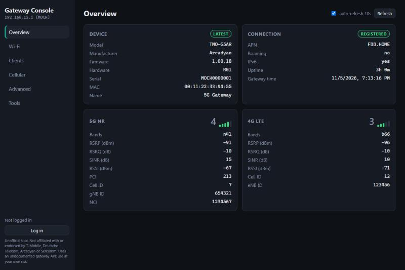
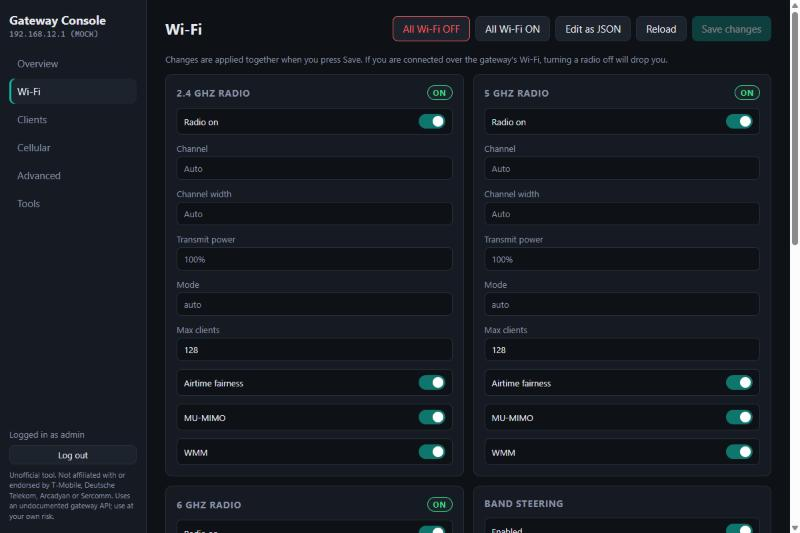

# Gateway Console

An unofficial, local-only management console for the Arcadyan and Sercomm gateways used by T-Mobile Home Internet. It talks to the gateway's own local API, the same one its built-in dashboard uses, and exposes what that dashboard and the mobile app hide. Chief among them: the per-radio Wi-Fi on/off switches.

Zero dependencies. One `node server.js`. Nothing leaves your machine except requests to the gateway on your LAN.

> **Not affiliated with, endorsed by, or supported by T-Mobile, Deutsche Telekom, Arcadyan, or Sercomm.**
> This tool uses an undocumented API that the manufacturer can change at any time. Changing gateway settings can disconnect devices. You are responsible for anything you do with it. See [Legal](#legal).




## Supported hardware

The console speaks the `TMI/v1` HTTP API found on the Arcadyan and Sercomm gateways. Nokia and Sagemcom gateways use different firmware and will **not** work.

| Gateway | API | Status |
|---|---|---|
| Arcadyan **TMO-G5AR** | 3.x, config at `/network/configuration/v2` | Tested (firmware 1.00.06) |
| Arcadyan **TMO-G4AR**, Sercomm **TMO-G4SE** | 1.x, config at `/network/configuration` | Expected to work, untested |
| Arcadyan **KVD21** | 1.x | Expected to work, untested |
| Nokia 5G21, Sagemcom Fast 5688W | different API | Not supported |

If you have a gateway in the "untested" rows, the Advanced tab's **Probe** button reports which endpoints your firmware answers. Paste that output into an issue and it can be supported.

## Why this exists

On the G5AR the T-Life app shows your network name and password and a frequency-band picker, but no way to turn a radio off, and it refuses to delete the last network. The built-in web dashboard shows the same. The gateway's API, however, has an `isRadioEnabled` flag on each radio. This console gives you that switch, plus everything else the API exposes.

## Requirements

- Node.js 18 or newer (uses the built-in `fetch`).
- A machine that can reach the gateway, normally at `192.168.12.1`. Through your own router is fine if the gateway is upstream of it; otherwise plug into one of its Ethernet ports or join its Wi-Fi.
- The gateway's admin password, printed on the sticker on the bottom of the unit.

## Run

### Any platform

```
node server.js
```

Open http://localhost:8787 and log in with username `admin` and the sticker password.

Options:

```
node server.js --gateway 192.168.12.1 --port 8787   # defaults
node server.js --auto-exit                           # quit on its own ~8s after the last console page closes
node server.js --mock                                # fake gateway for development, password "mock"
```

### Windows launcher

Run `install-shortcut.ps1` once to put a **Gateway Console** shortcut on your Desktop, or just double-click `Gateway Console.vbs`. It starts the server hidden, opens the console in its own app-style Edge or Chrome window, and stops the server when you close that window. Nothing keeps running afterward.

## What each tab does

| Tab | Backed by | What you can do |
|---|---|---|
| Overview | `GET /gateway?get=all` | Model, firmware, uptime, 5G and 4G signal with bars, RSRP, RSRQ, SINR. No login needed. |
| Wi-Fi | `GET/POST /network/configuration[/v2]?get=ap` | Radio on/off per band. On older firmware also channel, width, transmit power, MU-MIMO, WMM, band steering. Add, edit, hide, or remove SSIDs. "All Wi-Fi OFF/ON" quick buttons. "Edit as JSON" for anything the form does not know. |
| Clients | `GET /network/telemetry?get=clients` | Every connected device by band or Ethernet, with IP, MAC, signal. |
| Cellular | `GET /network/telemetry?get=all` | Full cell detail for both radios, SIM, GPS, gateway clock. |
| Advanced | anything under `/TMI/v1` | Raw request builder with presets, plus a probe that reports which known endpoints your firmware answers. Destructive-looking paths ask for confirmation. |
| Tools | `POST /gateway/reset?set=reboot` | Reboot (older firmware; the G5AR has no reboot endpoint). Export device info, config and telemetry as JSON, redacted by default so it is safe to attach to a bug report. |

The form in the Wi-Fi tab is generated from whatever the gateway returns, so fields that appear on your firmware but not in this list still show up as editable.

## What the gateway cannot do

The API exposes Wi-Fi settings, telemetry, reboot on some models, and the admin login. That is all. There is no bridge mode, IP passthrough, LAN subnet, DHCP range, port forwarding, or DMZ on these gateways, through this API or any other, and this console cannot add them. T-Mobile also places these gateways behind carrier-grade NAT, so inbound connections from the internet are blocked regardless of gateway settings.

If you need a LAN of your own, put your own router behind the gateway (double NAT is fine for everything outbound). If you need something reachable from outside, use a tunnel such as Tailscale or Cloudflare Tunnel.

## How it works and what it does not do

- `server.js` serves the static UI and proxies `/api/*` to `http://<gateway>/TMI/v1/*`. It binds to `127.0.0.1` only and refuses requests whose `Host` or `Origin` header is not localhost.
- Gateway calls require a custom `X-Gateway-Console` header. A web page on another site cannot add one without a CORS preflight, which the server never grants, so a malicious page in your browser cannot drive the proxy.
- The UI is served with a Content Security Policy that blocks any script or connection not from the console itself.
- The gateway password is sent once to the gateway's login endpoint and never stored. The returned token lives in the browser tab's `sessionStorage` and is gone when the tab closes.
- Nothing is written to disk. There is no telemetry, analytics, update check, or network access of any kind beyond the gateway you point it at.
- The JSON export redacts IMEI, SIM identifiers, phone number, serial, MAC addresses, Wi-Fi passwords, and GPS by default. Tick the box only for a private backup.

## Troubleshooting

- **"Gateway unreachable"**: the machine cannot reach the gateway address. Check you can open `http://192.168.12.1/` in a browser. Pass `--gateway` if yours is elsewhere.
- **Login fails**: the password is the one on the sticker, unless you changed it in the dashboard or the app. Username is `admin`.
- **Wi-Fi tab shows an error**: your firmware may use a path this console does not know. Run the probe in the Advanced tab and open an issue with the output.
- **After saving Wi-Fi the form goes blank**: the G5AR returns an empty config for a few seconds after a write. The console waits and reloads; press Reload if it does not.
- **The gateway's screen says "issue with Wi-Fi, unplug to reset"**: that is what the G5AR displays whenever all radios are off. It is cosmetic. Internet is unaffected.

## Firmware notes

- G5AR (API 3.1): config lives at `/network/configuration/v2`; the non-v2 path returns 404. Each radio exposes only `isRadioEnabled`. A write returns 200 with an empty body, and the config reads back empty for a few seconds. Telemetry has no `time` key and the 5G block has no `status` flag.
- The stock G5AR dashboard reads `/version` and switches to the v2 path when the API version is 1.6 or higher. It never shows the radio switches and has no reboot.
- These endpoints were identified by reading the JavaScript the gateway itself serves at `http://192.168.12.1/`. No authentication was bypassed and no firmware was extracted.

## Contributing

Issues and pull requests are welcome, especially probe output and config shapes from gateways in the untested rows. Keep the project dependency-free. Run `npm run check` before sending a change. Please redact IMEI, SIM, serial, and MAC values from anything you paste; the export tool does that for you.

## Legal

**License.** MIT. See [LICENSE](LICENSE).

**No affiliation.** This is an independent project. It is not made, endorsed, sponsored, or supported by T-Mobile US, Inc., Deutsche Telekom AG, Arcadyan Technology Corporation, or Sercomm Corporation. T-Mobile and the T-Mobile logo are trademarks of Deutsche Telekom AG. Arcadyan and Sercomm are trademarks of their respective owners. Product and model names are used only to identify compatible hardware, and no trademark use is intended beyond that identification. No logos, artwork, or proprietary code from any of these companies are included.

**No warranty, your responsibility.** The software is provided as is, without warranty of any kind. It drives an undocumented interface. Firmware updates may change or remove it without notice. Changing gateway settings can disconnect devices or leave a gateway in a state you need a factory reset to recover from. You alone are responsible for how you use it and for compliance with the terms of service of your internet provider.

**Security.** Do not expose the server to a network. It is designed to be reached from the same machine only. See [SECURITY.md](SECURITY.md).
